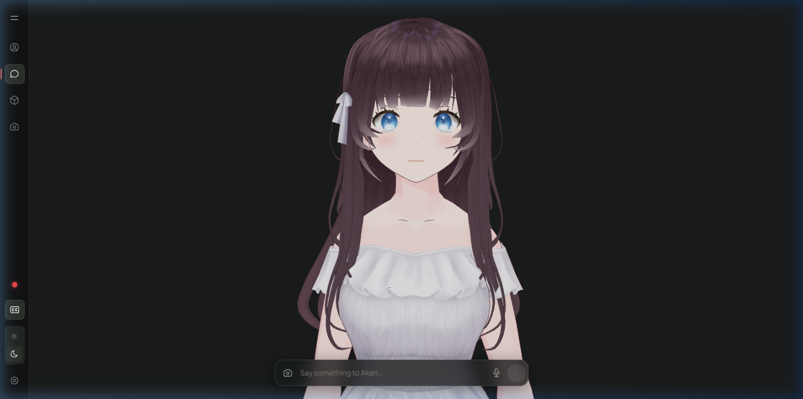

# Phase 00: Master Implementation Roadmap & System Architecture
**Version**: 1.0.0  
**Target Goal**: Build the complete, production-ready Multimodal 3D VRM AI Companion from scratch.  
**Related Directory**: `./docs/implementation/`

---

## 1. Executive Vision & Architecture

The application is an interactive, low-latency conversational AI companion featuring:
- A **3D VRM anime avatar** running in WebGL/Three.js at 60 FPS.
- Real-time **audio-reactive mouth lip-sync** and **audio-synchronized facial expressions**.
- A full-duplex **WebSocket streaming bridge** uniting browser microphone recording, streaming Whisper speech recognition, and parallel text-to-speech audio synthesis.
- A **multi-provider LLM gateway** supporting Amazon Bedrock Mantle, OpenAI, Mistral AI, OpenRouter (Gemma 4 native function calling), and Free.ai.
- A **20-round agentic tool calling engine** with live Tavily web search, web page extraction, timezone clock, AST math evaluation, and dynamic tool discovery.
- **Hybrid multimodal vision** with client-side offscreen canvas compression and background visual extraction fallback.
- **Summary buffer memory compaction** to prevent context drift in long sessions.

```
+-----------------------------------------------------------------------------------------+
|                                    CLIENT BROWSER (React 19 + Three.js)                 |
|                                                                                         |
|  [3D Viewport]                                          [Glassmorphic UI]               |
|  +---------------------------+                          +----------------------------+  |
|  | Three.js VRM Humanoid     |                          | Screen Router:             |  |
|  | - Akari (default.vrm)     |                          | - Characters (Overview)    |  |
|  | - Espeon (Espeon.vrm)     |                          | - Chat (Text / Cam / Audio)|  |
|  | Controllers:              |                          | - Stream (Voice Call)      |  |
|  | - Blink / Breathing       |                          | - Settings (LLM & Tools)   |  |
|  | - LookAt (Camera Tracking)|                          | - Gallery                  |  |
|  | - EmotionController (Lerp)|                          +----------------------------+  |
|  | - LipSyncController (FFT) |                                        |                 |
|  +---------------------------+                                        |                 |
|               ^                                                       |                 |
|               | (Audio Events & RMS)                                  v                 |
|  [Web Audio Subsystem]                                  [AvatarSocket Networking]       |
|  - SpeechQueue (Segmented Playback)                     - Binary: PCM Audio / Interrupt |
|  - AudioPlayer / AnalyserNode                           - JSON: Chat, Config, Telemetry |
+-----------------------------------------------------------------------------------------+
                                             ▲
                                             │ WebSocket (ws://127.0.0.1:8765)
                                             ▼
+-----------------------------------------------------------------------------------------+
|                                    BACKEND SERVER (Python 3.11+ Asyncio)                |
|                                                                                         |
|  [WebSocket Bridge] (./server/src/bridge/websocket_server.py)                           |
|  - Connection Manager & Broadcaster (./server/src/bridge/broadcaster.py)                |
|  - Binary PCM Stream Ingestion & Interrupt Router                                       |
|                                                                                         |
|  [Voice & ASR Subsystem]                                [Chat Processing Loop]          |
|  - Streaming Whisper (small.en)                         - ./server/src/chat/loop.py     |
|  - Server Mic ASR (medium.en)                           - Stream Cancellation Event     |
|  - Mutual Exclusion Model Manager                       - Dialogue Chunking Engine      |
|                                                                       │                 |
|  [Agentic Tool Registry] (./server/src/tools/)                        v                 |
|  - 12 Built-in Tools (Web Search, Time, Math, Status)   [LLM Multi-Provider Gateway]     |
|  - Resilient Aliasing & Dynamic Discovery               - AWS Bedrock Mantle            |
|  - 20-Round Multi-Turn Execution Loop                   - OpenAI Direct                 |
|                                                         - Mistral AI                    |
|  [TTS & Audio Synthesis]                                - OpenRouter Free Tier          |
|  - Fish Audio Streaming API                             - Free.ai Gateway               |
|  - GPT-SoVITS Dual Endpoint                             - Hybrid Vision Analyzer        |
|  - Sentence-level Audio Encoding                        - Summary Buffer Compactor      |
+-----------------------------------------------------------------------------------------+
```

---

## 2. Visual Layout & Screenshots

The application user interface is divided into clean, glassmorphic screens:

### 2.1 Characters / Overview Screen (`?screen=characters`)
Displays the interactive companion selection deck, hero category tags, companion stats, and 3D preview.


### 2.2 Chat Screen (`?screen=chat`)
Provides the full 3D interactive character viewport with camera controls, real-time subtitle overlay, camera input, and glassmorphic chat input bar.


### 2.3 Settings Screen (`?screen=settings`)
Exposes inference provider selection (AWS Bedrock, OpenAI, Mistral, OpenRouter, Free.ai), model catalogs, bearer tokens/API keys, and the interactive tools catalog.


---

## 3. Step-by-Step Implementation Roadmap

If you only have this `./docs/implementation/` directory, follow these sequential steps to construct the entire project from zero:

1. **[01: Project Scaffolding & Environment Setup](./01_project_scaffolding_and_environment.md)**:
   - Setting up `./client/` (Vite, React 19, TypeScript, Tailwind CSS).
   - Setting up `./server/` (Python 3.11+, uv, dependencies, `.env`).
   - Establishing directory structure and environment contracts.

2. **[02: 3D VRM Engine & Character Controllers](./02_3d_vrm_engine_and_character_controllers.md)**:
   - Setting up `@pixiv/three-vrm` in React Three Fiber.
   - Procedural blinking, breathing, and look-at tracking.
   - Dynamic multi-character loading (`default.vrm` & `Espeon.vrm`) with WebGL memory disposal.
   - Windows Vite watcher EBUSY crash fix.

3. **[03: Full-Duplex WebSocket Bridge & Streaming Whisper ASR](./03_full_duplex_websocket_bridge_and_asr.md)**:
   - WebSocket protocol with binary PCM audio streaming & JSON event multiplexing.
   - Dedicated low-latency streaming Whisper model (`chat_whisper.py`).
   - Server mic ASR loop and model mutual exclusion.

4. **[04: Multi-Provider LLM & Bedrock Mantle Integration](./04_llm_inference_and_bedrock_mantle.md)**:
   - Unified multi-provider router (`provider.py`).
   - Amazon Bedrock Mantle OpenAI-compatible integration with HTTP Bearer Token.
   - OpenAI, Mistral AI, OpenRouter (Gemma 4 native function calling), Free.ai.
   - Windows console UTF-8 fix and modal boundary history sanitization.

5. **[05: Agentic Tool Calling & Real-Time Search](./05_agentic_tool_calling_and_search.md)**:
   - `ToolRegistry` with resilient aliasing.
   - 12 registered tools (time, date, math, system status, Tavily web search/reader).
   - Mandatory pre-decline tool verification rule and 20-round window scaling.
   - Anti-stalling intent recovery.

6. **[06: Audio-Synchronized Emotion & Lip-Sync Subsystem](./06_audio_synchronized_emotion_and_lipsync.md)**:
   - Sentence-level emotion tag parser and regex chunker.
   - Parallel sentence TTS audio synthesis.
   - Client `SpeechQueue` triggering facial expressions the exact millisecond audio starts.
   - Real-time Web Audio `AnalyserNode` FFT energy mapping to mouth blendshapes.

7. **[07: Multimodal Vision & Conversation Memory Compaction](./07_multimodal_vision_and_memory_compaction.md)**:
   - Client offscreen canvas downscaler (1280x1280 JPEG 0.85).
   - Hybrid vision routing (native multimodal vs background vision extractor).
   - Summary buffer memory compactor for long conversations.

8. **[08: Glassmorphic UI Screens, Navigation & Integration](./08_glassmorphic_ui_screens_and_navigation.md)**:
   - Screen routing (`characters`, `chat`, `stream`, `settings`, `galary`).
   - Clean URL query parameter synchronization (`?screen=...&character=...&model=...`).
   - Theme switcher (dark/neon/light), mobile responsiveness, and end-to-end verification.
