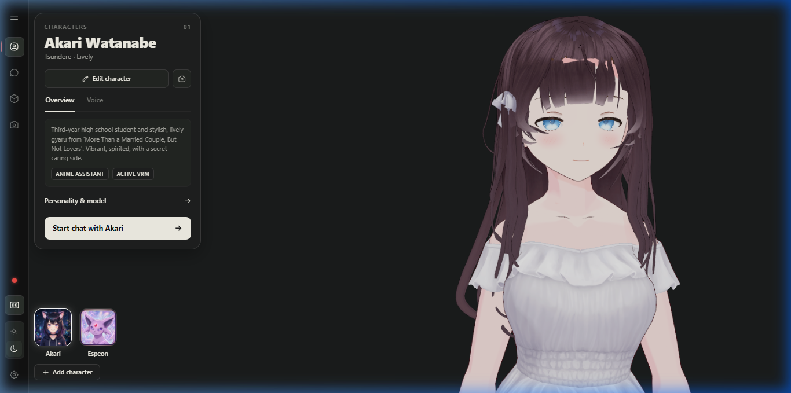

# Phase 02: 3D VRM Engine & Character Controllers
**Task**: Implement Three.js WebGL rendering, VRM model loading with `@pixiv/three-vrm`, procedural animation controllers, multi-character hot-swapping, and memory disposal.  
**Related Phase**: `./docs/implementation/01_project_scaffolding_and_environment.md`  
**Referenced Skill**: `./.agents/skills/vrm-3d-avatar-engine/SKILL.md`

---

## 1. Architectural Goal

Provide a 60 FPS 3D anime avatar viewer in React Three Fiber that:
1. Loads humanoid VRM models (`default.vrm` and `Espeon.vrm`).
2. Supports dynamic hot-swapping between characters without unmounting the canvas or leaking WebGL GPU memory.
3. Provides natural procedural animations: periodic eye blinking, breathing body oscillation, and camera look-at tracking.
4. Lerps between 6 core facial expression presets (`Happy`, `Sad`, `Angry`, `Surprised`, `Relaxed`, `Neutral`).



---

## 2. Agent Skill & Implementation Prompt

When delegating this phase to an AI agent, use the following prompt:

```markdown
Build a 3D VRM character viewer in `./client/src/components/character/` using `@pixiv/three-vrm` and `@react-three/fiber`:
1. Implement `AvatarLoader.ts` using `GLTFLoader` with `VRMLoaderPlugin`.
2. Implement `Character.tsx` managing avatar lifecycle, frame loop updates (`useFrame`), and clean WebGL disposal (`disposeAvatar`) when switching models.
3. Build procedural controllers:
   - `BlinkController.ts`: Randomized 2–6s eye blinking.
   - `BreathingController.ts`: Sine-wave spinal breathing motion.
   - `LookAtController.ts`: Head tracking following the active camera position.
   - `EmotionController.ts`: Lerps between Happy, Sad, Angry, Surprised, Relaxed, Neutral, strictly ignoring mouth visemes.
4. Declare multi-character registry in `types.ts` supporting Akari Watanabe (`default.vrm`) and Espeon (`Espeon.vrm`).
5. Ensure defensive bone lookups (`vrm.humanoid?.getNormalizedBoneNode(...)`) to handle skeletal differences.
```

---

## 3. Core Implementation

### 3.1 Avatar Loader (`./client/src/components/character/AvatarLoader.ts`)

```typescript
import * as THREE from "three";
import { GLTFLoader } from "three/examples/jsm/loaders/GLTFLoader.js";
import { VRMLoaderPlugin, VRM } from "@pixiv/three-vrm";
import { createVRMAnimationClip } from "@pixiv/three-vrm-animation";

export interface LoadedAvatar {
  vrm: VRM;
  mixer: THREE.AnimationMixer;
}

export async function loadAvatar(url: string): Promise<LoadedAvatar> {
  const loader = new GLTFLoader();
  loader.register((parser) => new VRMLoaderPlugin(parser));

  const gltf = await loader.loadAsync(url);
  const vrm = gltf.userData.vrm as VRM;
  const mixer = new THREE.AnimationMixer(vrm.scene);

  return { vrm, mixer };
}
```

### 3.2 WebGL Resource Disposal (`./client/src/components/character/Character.tsx`)

To prevent browser GPU memory leaks when hot-swapping between Akari and Espeon:

```typescript
function disposeAvatar(vrm: any, mixer?: THREE.AnimationMixer) {
  try {
    if (mixer) {
      mixer.stopAllAction();
      if (vrm?.scene) {
        mixer.uncacheRoot(vrm.scene);
      }
    }
    const root = vrm?.scene || vrm;
    root?.traverse?.((obj: any) => {
      if (obj.geometry) {
        obj.geometry.dispose();
      }
      if (obj.material) {
        if (Array.isArray(obj.material)) {
          obj.material.forEach((m: any) => m?.dispose?.());
        } else {
          obj.material?.dispose?.();
        }
      }
    });
  } catch (err) {
    console.warn("[Avatar] Cleanup warning:", err);
  }
}
```

### 3.3 Procedural Blink Controller (`./client/src/components/character/BlinkController.ts`)

```typescript
import type { VRM } from "@pixiv/three-vrm";

export class BlinkController {
  private blinkTimer = 0;
  private nextBlinkInterval = 3.0;
  private isBlinking = false;
  private blinkProgress = 0;

  update(delta: number, vrm: VRM) {
    if (!vrm.expressionManager) return;

    if (!this.isBlinking) {
      this.blinkTimer += delta;
      if (this.blinkTimer >= this.nextBlinkInterval) {
        this.isBlinking = true;
        this.blinkTimer = 0;
        this.blinkProgress = 0;
        this.nextBlinkInterval = 2.0 + Math.random() * 4.0;
      }
    } else {
      this.blinkProgress += delta * 12.0; // Fast blink (~150ms)
      if (this.blinkProgress >= Math.PI) {
        this.isBlinking = false;
        vrm.expressionManager.setValue("blink", 0);
      } else {
        const weight = Math.sin(this.blinkProgress);
        vrm.expressionManager.setValue("blink", weight);
      }
    }
  }
}
```

### 3.4 Sinusoidal Breathing Controller (`./client/src/components/character/BreathingController.ts`)

```typescript
import type { VRM } from "@pixiv/three-vrm";

export class BreathingController {
  private elapsedTime = 0;

  update(delta: number, vrm: VRM) {
    this.elapsedTime += delta;
    const spine = vrm.humanoid?.getNormalizedBoneNode("spine");
    if (spine) {
      const breath = Math.sin(this.elapsedTime * 1.5) * 0.015;
      spine.rotation.x = breath;
    }
  }
}
```

### 3.5 LookAt Camera Tracker (`./client/src/components/character/LookAtController.ts`)

```typescript
import * as THREE from "three";
import type { VRM } from "@pixiv/three-vrm";

export class LookAtController {
  private target = new THREE.Vector3();

  setTarget(pos: THREE.Vector3) {
    this.target.copy(pos);
  }

  update(vrm: VRM) {
    if (vrm.lookAt) {
      vrm.lookAt.lookAt(this.target);
    }
  }
}
```

---

## 4. Verification & Testing Instructions

### 4.1 Visual Verification in Browser
1. Start the client dev server:
   ```bash
   cd client
   bun run dev
   ```
2. Open `http://localhost:5173/?screen=characters&character=akari`.
3. **Verify**:
   - The 3D model of Akari renders in WebGL with ambient and directional lighting.
   - Her eyes blink naturally every 2–6 seconds.
   - Her chest subtly rises and falls in continuous breathing motion.
   - Her eyes and head subtly follow your camera rotation when dragging with the mouse.
4. Click on the **Espeon** companion card in the selector.
   - Verify that Akari unmounts cleanly and Espeon loads in 3D without errors in the browser console.
   - Verify that switching back to Akari repeats cleanly.

### 4.2 Automated Build Verification
```bash
cd client
bun run build
```
**Expected Outcome**: Zero TypeScript errors, zero asset resolution errors.
