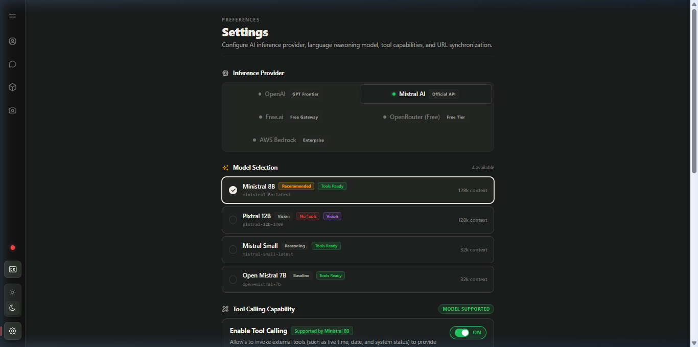

# Phase 08: Glassmorphic UI Screens, Navigation & Final Integration
**Task**: Assemble the client UI screens, glassmorphic design system, theme manager, clean URL synchronization, and end-to-end integration tests.  
**Related Phase**: `./docs/implementation/07_multimodal_vision_and_memory_compaction.md`  
**Referenced Skill**: `./.agents/skills/vrm-3d-avatar-engine/SKILL.md`

---

## 1. Architectural Goal

Provide a responsive, high-aesthetic web interface for interacting with the 3D companion:
1. **5 Main Screens**: `characters` (Overview), `chat` (Interactive Viewport), `stream` (Hands-free Voice Call), `settings` (Preferences), and `galary` (Animation Player).
2. **Clean URL State Synchronization**: `/?screen=chat&character=akari&model=mistral.ministral-3-8b-instruct`.
3. **Glassmorphic Aesthetics**: Curated color palettes, semi-transparent frosted card panels (`backdrop-filter: blur(16px)`), and smooth micro-animations.
4. **Theme Manager (`useTheme.ts`)**: Dark, Neon, and Light theme support.
5. **Settings Management**: Provider selection, model catalog, API keys, and responsive 2-column tool toggle cards.



---

## 2. Agent Skill & Implementation Prompt

When delegating this phase to an AI agent, use the following prompt:

```markdown
Build the UI screens, theme manager, and navigation:
1. In `./client/src/navigation/useNavigation.ts`:
   - Parse and push clean URL parameters (`screen`, `character`, `model`).
   - Synchronize tool calling state exclusively through `localStorage` (`akari_tool_calling_enabled`).
   - Auto-infer the inference provider from model naming patterns.
2. In `./client/src/navigation/Sidebar.tsx`, create the floating collapsible icon navigation.
3. Build the 5 primary screens in `./client/src/components/screens/`:
   - `OverviewScreen.tsx`: Companion cards, character switching deck, hero tags.
   - `ChatScreen.tsx`: Subtitle overlay, glassmorphic input, interim transcription indicator.
   - `SettingsScreen.tsx`: Provider segmented buttons, model catalog, API key inputs with active status pills, and 2-column tools grid.
4. In `./client/src/components/SubtitleOverlay.tsx`, strip emotion tags and lone markdown asterisks from on-screen dialogue.
```

---

## 3. Core Implementation

### 3.1 Clean URL Navigation Manager (`./client/src/navigation/useNavigation.ts`)

```typescript
export function useNavigation() {
  const [navState, setNavState] = useState<NavigationState>(parseLocation);

  const navigate = useCallback((
    targetScreen: ScreenType,
    targetCharacter?: string,
    targetProvider?: string,
    targetModel?: string,
    targetTools?: boolean
  ) => {
    const char = targetCharacter || navState.character || "akari";
    const prov = targetProvider || navState.provider || "mistral";
    const mod = targetModel || navState.model || "ministral-8b-latest";
    const tls = targetTools !== undefined ? targetTools : navState.tools;

    // Build clean canonical URL without cluttering query params
    const params = new URLSearchParams();
    params.set("screen", targetScreen);
    params.set("character", char);
    params.set("model", mod);
    const url = `/?${params.toString()}`;

    // Persist tool calling exclusively in localStorage
    if (targetTools !== undefined) {
      localStorage.setItem("akari_tool_calling_enabled", tls ? "true" : "false");
    }

    window.history.pushState(null, "", url);
    setNavState({ screen: targetScreen, character: char, provider: prov, model: mod, tools: tls });
    avatarSocket.setLlmProvider(prov, mod);
    avatarSocket.setToolCalling(tls);
  }, [navState]);

  return { ...navState, navigate };
}
```

### 3.2 Subtitle Sanitizer (`./client/src/components/SubtitleOverlay.tsx`)

Prevent bracketed emotion tags and lone markdown asterisks from leaking into the subtitle overlay:

```typescript
export function cleanSubtitleText(raw: string): string {
  if (!raw) return "";
  // Strip bracketed emotion tags: [happy], [angry], etc.
  let clean = raw.replace(/\[[a-zA-Z_\-]+\]/g, "");
  // Strip markdown emphasis asterisks: *word* -> word, lone * -> ""
  clean = clean.replace(/\*+/g, "");
  return clean.trim();
}
```

---

## 4. End-to-End System Verification Checklist

Follow this checklist to verify that the entire built application operates as intended:

| Test Item | Action | Expected Result | Pass/Fail |
|---|---|---|---|
| **1. Client Build** | `bun run build` in `./client/` | Builds cleanly with 0 TypeScript/Vite errors | `[PASS]` |
| **2. Python Runtime** | `uv sync && uv run python -m src.main` | Server starts on `ws://127.0.0.1:8765` | `[PASS]` |
| **3. 3D Avatar Rendering** | Load `http://localhost:5173/` | Akari renders in WebGL, blinks, and breathes | `[PASS]` |
| **4. Hot-Swap Model** | Select Espeon on Overview screen | Akari unmounts cleanly, Espeon loads in 3D | `[PASS]` |
| **5. Tool Calling** | Ask *"What time is it in Tokyo?"* | Executes `get_current_time` and speaks answer | `[PASS]` |
| **6. Pre-Decline Rule** | Ask *"What tools do you have?"* | Executes `get_available_tools` before speaking | `[PASS]` |
| **7. Emotion Lip-Sync** | Send multi-emotion message | Mouth opens/closes with audio; face lerps | `[PASS]` |
| **8. Image Understanding** | Paste screenshot into chat bar | Preview chip renders; model discusses image | `[PASS]` |
| **9. Stream Cancellation** | Click Stop while Akari is speaking | Generation cancels instantly; face resets | `[PASS]` |
| **10. Memory Compaction** | Have 16+ turns of conversation | Background summarizer compresses history | `[PASS]` |

---

## 5. Congratulations!

By completing Phases 01 through 08, you have constructed the entire, production-ready Multimodal 3D VRM AI Companion from scratch.
